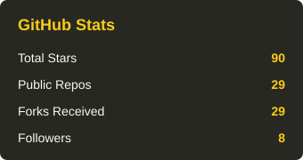
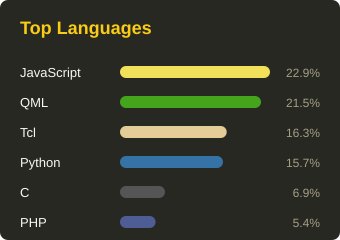

📍 Indonesia

---

## 🧰 Tech & tools

---

## 📊 GitHub stats

---

### 🌐 Let's connect

Building something with AI agents? Reach out — always happy to talk.

[snapgate.tech](https://snapgate.tech) · [LinkedIn](https://www.linkedin.com/in/herdodimas46)

